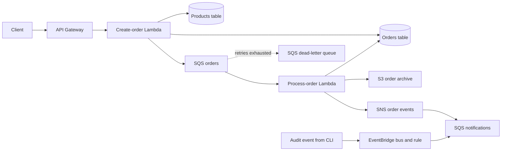

# Terraform + Floci: a hands-on workshop

A chapter-by-chapter runbook for learning Terraform on **your own Windows, macOS, or Linux machine**.
Build a local order-processing system, inspect what Terraform does, practice state operations,
and remove everything when you finish. No AWS account or real AWS credentials are needed.

**Start here: [Chapter 00 — Set up your machine](runbooks/00-setup.md).**

MVP **0.1.0** includes the full course, maintained checks, and a source ZIP builder.
See [MVP acceptance](runbooks/acceptance.md) for the requirement mapping and the
[validation record](runbooks/validation.md) for tested platforms and known emulator limitations.

## How to use this workshop

Read one chapter at a time. Each includes a goal, prerequisites, files to inspect, exact commands,
expected results, an exercise, troubleshooting, and a completion checkpoint.
Runbooks use the repository root and one working directory named `lab/`.
Keep that same directory and its state throughout the course; do not start a separate state per chapter.

`examples/01/` through `examples/12/` contain **incremental reference files**, not standalone projects.
The chapter copier adds/replaces only that chapter's files in `lab/`, backs up changed files under
`.workshop/backups/`, and preserves Terraform state and your `terraform.tfvars`.
It never runs Terraform or marks an exercise as passed. Inspect the source and make predictions before applying.
Provider-introduction chapters include dependency lock files for the tested versions.
You can type the reference files yourself instead of copying them; the copier is the supported fast-start path.

All Terraform commands are real CLI commands. AWS verification uses a small transparent wrapper:

```text
python ../scripts/aws_local.py s3api list-buckets
```

This runs `aws --endpoint-url http://localhost:4566 --region us-east-1 s3api list-buckets`
with fake credentials and consistent JSON output. It avoids shell-specific quoting and credential setup.
Where your OS calls Python `python3`, use `python3` instead of `python` in every command.

## Chapters

| Chapter | What you build or learn | Checkpoint |
| --- | --- | --- |
| [00 — Setup](runbooks/00-setup.md) | Tools, Docker, local AWS endpoints | Floci healthy; CLI returns empty lists |
| [01 — Foundation](runbooks/01-foundation.md) | Providers, variables, locals, outputs, tfvars | Provider reads local identity |
| [02 — Storage and database](runbooks/02-storage-database.md) | Resource addresses, S3, DynamoDB, state | Two buckets and two tables |
| [03 — Random and local providers](runbooks/03-random-local.md) | Multiple providers, templates, references | Generated application configuration |
| [04 — Messaging](runbooks/04-messaging.md) | SQS, DLQ, SNS, `count`, dependencies | SNS message reaches SQS |
| [05 — Configuration and secrets](runbooks/05-configuration-secrets.md) | SSM, `for_each`, secrets, KMS, sensitive state | Parameters and encrypted fake secret |
| [06 — IAM](runbooks/06-iam.md) | Trust policies, permissions, attachments | Lambda execution role |
| [07 — Lambda](runbooks/07-lambda.md) | Python, archives, logs, event-source mapping | Order processed, archived, and notified |
| [08 — API Gateway](runbooks/08-api.md) | API integration, deployment, lifecycle | HTTP request completes the workflow |
| [09 — EventBridge](runbooks/09-events.md) | Bus, rule, target, resource policy | Audit event reaches SQS |
| [10 — Terraform expressions](runbooks/10-expressions.md) | Functions, console, graph, lifecycle | Explain dependency and expression results |
| [11 — State operations](runbooks/11-state.md) | Drift, import, replacement | Repair drift and adopt an existing parameter |
| [12 — Modules](runbooks/12-modules.md) | Inputs, outputs, `moved` blocks | Refactor storage without replacement |
| [13 — Remote state (optional)](runbooks/13-remote-state.md) | Bootstrap, S3 backend, locking, migration | Migrate to Floci S3 and back |
| [14 — Cleanup and repeat](runbooks/14-cleanup.md) | Destroy plan, reverse dependencies, verification | Managed application resources removed |

Read [troubleshooting](runbooks/troubleshooting.md) if a checkpoint fails.
[Validation notes](runbooks/validation.md) distinguish tested behavior from platform guidance.
[MVP.md](MVP.md) preserves the original requirements; these runbooks define the learner workflow.

## The application you will build



Supporting resources include IAM, SSM, Secrets Manager, KMS, CloudWatch logs, an assets bucket,
and generated local configuration. The reference reaches **36 managed resources** in Chapter 09
with the optional failure topic enabled; the import exercise adds one. Data sources do not count.
API integration and queue permissions make the total slightly larger than the original 20–30 target.

This workload illustrates infrastructure and asynchronous delivery. DynamoDB and SQS writes are
not atomic, notifications can duplicate on retries, and the local API has no customer authentication.
It is a learning application, not a production storefront.

## Repository map

```text
runbooks/           Chapters and troubleshooting
examples/           Reference files added or replaced by each chapter
scripts/            Chapter copier, local AWS wrapper, workload checks
config/             Fake local AWS profile
compose.yaml        Persistent local Floci instance
compose.lambda.yaml Docker socket configuration introduced in Chapter 07
lab/                Your working Terraform project (created in Chapter 01)
state-bootstrap/    Optional separate backend project (Chapter 13)
```

The workshop's `examples/` source and dependency lock files belong in Git. The generated learner
directories `lab/` and `state-bootstrap/` are ignored by default. To track your own exercises in this
checkout, remove only those two directory entries from `.gitignore`, then review and stage your source
and `.terraform.lock.hcl` files. Keep the existing state, plan, tfvars, generated-file, and tool exclusions.
Do not commit state, plan files, generated configuration, real secrets, or downloaded tools.
The emulator volume and Terraform state are separate: preserve both between sessions.

## Check or distribute the workshop

Authors can validate source and every cumulative chapter without provisioning resources:

```text
python scripts/check_workshop.py
```

Build the versioned learner download with:

```text
python scripts/package_workshop.py
```

The ZIP and checksum are written under `dist/`; it contains the source and runbooks needed to start
on a new machine. The full integration runner and GitHub Actions workflow are documented in
[maintaining the workshop](runbooks/maintaining.md). Learners follow the numbered chapters.
